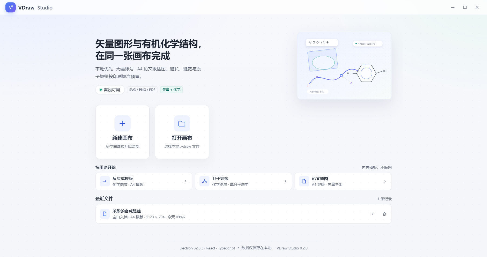
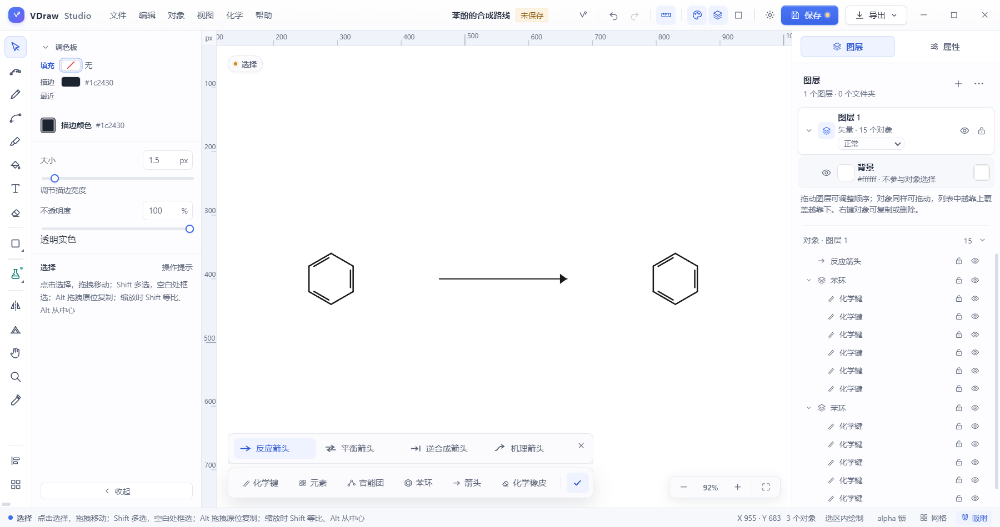
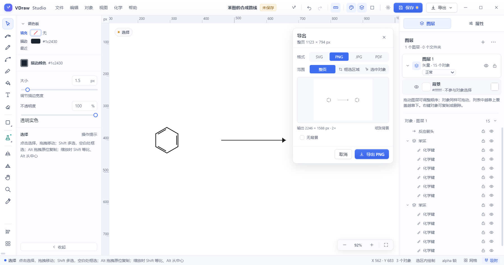

# VDraw Studio 0.3.0

<p>
  <a href="https://github.com/XiaoMoGu747/vdraw-studio/actions/workflows/ci.yml"></a>
  <a href="https://github.com/XiaoMoGu747/vdraw-studio/releases"></a>
  
  
  
  
  
</p>

本地优先的 PC 桌面矢量绘图与二维有机化学结构编辑器。Electron + React + TypeScript + Vite，
无账号、无云端、无网络依赖，所有文件保存在本机。

## 下载

Windows 安装包（x64 · NSIS · 约 76 MB）发布在 [Releases](https://github.com/XiaoMoGu747/vdraw-studio/releases) 页面，直接下载最新版：

**[→ 下载 VDraw Studio](https://github.com/XiaoMoGu747/vdraw-studio/releases/latest)**

| 产物 | 说明 |
| --- | --- |
| `VDraw.Studio-<版本>-x64.exe` | Windows x64 安装程序，可选安装目录，自动创建桌面与开始菜单快捷方式（GitHub 会把文件名里的空格转成点） |

安装后从开始菜单或桌面快捷方式启动；卸载走「设置 → 应用 → VDraw Studio」。

> 安装包未做代码签名，Windows SmartScreen 首次运行会提示「未知发布者」，点「更多信息 → 仍要运行」即可。

macOS / Linux 的构建目标已在 `package.json` 中配置，但暂无预编译产物，需按下文自行构建。



## 快速开始

```bash
npm install
npm run dev       # Vite + Electron 开发模式
npm run build     # 设计令牌 + 对比度 + ESLint + 类型检查 + 生产构建
npm start         # 构建后启动桌面应用
npm run design:lint   # 字号 / 圆角 / z-index / 色值 / 间距 / 动效守门
npm run contrast:lint # 浅色 / 深色语义色对 WCAG AA 校验
npm run lint      # ESLint 轻量基线
npm test          # node:test 单元测试（esbuild 打包 TS）
npm run smoke     # 端到端冒烟 + axe-core 可访问性审计 + 截图与导出文件
npm run smoke:dev # 开发模式链路验证
npm run pack      # 构建 Windows 免安装目录（release/win-unpacked）
npm run dist:win  # 构建 Windows NSIS 安装包（release/*.exe）
npm run gui:check # 对打包产物做一次真实 GUI 启动/新建画布/截图检查
npm run check:tools-ui # 对打包产物校验工具入口/面板可达性（33 项）
npm run check:brush-handoff # 对打包产物校验四种笔刷"实时层→矢量层"的像素一致性
```

若 Electron 二进制下载失败（网络限制），可使用镜像：

```powershell
$env:ELECTRON_MIRROR='https://npmmirror.com/mirrors/electron/'
node node_modules/electron/install.js
```

`npm run pack` / `npm run dist:win` 通过 `scripts/package.mjs` 默认使用 npmmirror 下载 Electron/NSIS 二进制；如需其他镜像，可在运行前设置 `ELECTRON_MIRROR` 和 `ELECTRON_BUILDER_BINARIES_MIRROR`。打包脚本会自动清除 `ELECTRON_RUN_AS_NODE`，避免 Electron 被当作 Node 执行。

## 功能

### 矢量绘图

- 矩形、正方形、椭圆、圆形、多边形、直线、曲线、文本
- 钢笔工具：点击创建节点，拖拽生成贝塞尔控制柄，点击首节点闭合，`Enter` 结束
- 曲线工具：初始绘制直线；拖拽线身会添加一个可拖拽点并平滑弯曲，右键删除该点并还原形状；双击进入节点编辑
- 节点工具：拖动节点与紫色控制柄编辑路径；Shift 多选节点、双击节点切换尖角/平滑、双击路径加点、Delete 删点；手工调过的控制柄不会被曲线自动平滑覆盖
- 画笔：硬笔 / 铅笔 / 硬圆 / 马克 四种预设，每支预设自带硬度/间距/纹理/平滑；绘制期由 Canvas 实时层按"压感宽度 + 可调软边 + 颗粒"即时呈现，手写笔倾斜时笔尖变扁并随倾斜方向旋转，倾斜信息会写入节点，落笔后的矢量轮廓与导出同样保持扁笔效果；实时层每帧用与落笔**同一条几何/材质管线**整条重建（单路径填充、同一 dab 种子），松手不会出现变浅/变细；收笔渐隐按 36px 绝对值封顶，硬圆预设默认不做抖动修正；硬度/间距/纹理随笔迹保存，并以派生矢量软边 + stamp dab（沿路径定距铺排、方向场椭圆、固定种子墨量）渲染与导出（不引入位图，不改变路径可编辑性）；绘制期实时层与落笔后共用同一 dab 生成器、材质阈值与墨量分桶，普通勾线实时/成品都不额外加软边；流量控制整笔墨量（主体/软边/墨点），压感曲线 0.4–2.0 全局可调且实时/成品共用同一 gamma 映射，正片叠底让主体与 dab 分别与背景相乘；自定义笔刷可保存/套用（上限 200），随 `.vdraw` 的可选 `editor.customBrushes` 携带，打开时按名称+参数去重并入本机库；支持 `.vbrush` 笔刷库导入导出（校验版本/来源、2MB 上限；桌面端走原生保存对话框），自定义笔刷 chip 带 SVG 笔触缩略图；PNG/JPG 导出的逐 dab multiply 有 `check:blend` 像素校验；PDF 导出把 multiply 预乘到纸张底色，逐 dab 混合有单笔 240 / 文档 1200 预算，超出退化为分桶；支持单击落点、抖动平滑、对称镜像与跟随辅助线
- 文本：Canvas 实测包围盒（中英混排/字重/字距/行高）、横排竖排、点击已有文本直接编辑；输入 `^{2}` / `_{2}` 可生成上标/下标；框宽换行为渲染期软换行，段落原文不被改写（收窄再放宽可还原）；编辑浮层继承字体与旋转；中文输入法回车不再误提交
- 对象微调：选中对象后方向键 1px 微移（Shift 10px），长按连续移动，整个按键手势只写一条撤销记录
- 对象缩放：属性面板采用 Godot 风格 X / Y 百分比缩放，链式按钮可切换等比 / 独立；支持重置；位图以原始像素为 100%，其它对象以首次缩放时尺寸为基准；缩放键、苯环时双键/三键平行线间距与稠环内圈半径同步变化
- 油漆桶：点图形填整块；点空白按“区域填充”，支持断线容差（0–12px）与扩展（-2–4px），编组可递归命中；按住拖动可连续填充，整段手势合并为一条撤销记录
- 橡皮：默认仅擦当前图层（Alt 临时全图层），擦除中 Esc 真正回滚；文本/箭头/原子/键接触即整对象删除
- 曲线：单击线身插点（Alt 尖角）、Shift 反向弯曲、闭合路径可编辑；右键对象菜单可「闭合/断开路径」；手工调过的控制柄会被标记，曲线自动平滑不再覆盖
- 钢笔：右键结束、Alt+右键取消、双击结束、Backspace 撤点、Alt 关闭吸附、真实曲线预览与手柄
- 对称：镜像带来源标记，源对象移动/缩放/改样式后自动同步（拖拽在抬手时同步）；直接改镜像会提示并回到源对象状态；环系与挂接取代基也会镜像；轴线支持中线吸附与数值输入；对称模式/轴随 `.vdraw` 保存
- 辅助线：一点/两点透视补齐水平与垂直方向，吸附量化到可见射线并带 8% 迟滞；地平线可拖动，线密度/参考长度/透视点可调，"等大"按固定 px 生成可度量网格；选中 path/polygon/line 后可用单应变换做透视变形；辅助线模式/参数随 `.vdraw` 保存
- 可把当前画笔参数保存为自定义预设，随时套用或删除；预设会连带压感/渐隐一起恢复
- 图层面板支持混合模式（正片叠底/滤色/叠加/变暗/变亮），画布与 SVG 导出一致
- 状态栏「选区内绘制」把新笔迹裁剪到选中图形内部；「alpha 锁」让新笔迹只显示在已有墨迹范围内，两者画布/导出一致
- 低不透明度笔迹在自交处自动切段，交叉区域像真实墨水一样叠深；高不透明度仍是单条路径
- 矢量橡皮按笔迹轮廓擦除（含粗笔迹与贝塞尔曲线），保留对象身份；擦除后的填充孔洞以单路径 nonzero 输出，导出不依赖 SVG mask
- 画布单滚轮直接缩放（`Ctrl`/`⌘`+滚轮与触控板捏合同样缩放）；缩放百分比与 −/+/适应窗口已移入底部状态栏，不再占用画布右下角和工具横栏宽度；触屏支持双指平移缩放，笔在屏时自动忽略手掌触摸
- 选择与变换：框选、Shift 点击加选/减选、移动、8 向缩放、旋转手柄、数值精确变换；多选时同时显示每个对象外框与整体选框/手柄；旋转默认自由，按住 Shift 才按 15° 吸附；**拖动角手柄始终等比缩放长宽**，边手柄仍可单轴拉伸；移动/旋转拖拽只更新视觉 transform，缩放拖拽走精确预览文档，三类变换均抬手一次性提交（属性面板在抬手后刷新）；缩放时包围盒按 sx/sy、字号与笔迹宽度按统一因子变化，描边宽保持不变；Alt 从中心缩放、Alt 拖拽原位复制；属性面板提供 ±90° 旋转、水平/垂直翻转、上移/下移一层、转换为路径与对象级锁定
- 形状：多边形边数 3–24、星形内径、从中心绘制；描边虚线/点线/点划线、线帽与拐角；直线可带末端箭头；直线/曲线落点吸附已有对象端点；参数化形状可一键转换为可编辑路径
- 文本：斜体、字重、对齐、字距、行高、方向与颜色集中在右侧属性；横栏提供上下标与项目符号插入；选中文本后可在画布上拖动右边缘实时调整框宽
- 化学增强：任意元素符号输入、放置前设置形式电荷/同位素/孤对/自由基、重贴标签保留已录入的化学语义；新环可设 0.5–2 倍键长；反应条件支持两行；超价原子在画布内联标记；文档级"隐式氢"开关；化学菜单可导出 MOL (V2000) 与 SMILES
- 视图与发现性：缩放工具支持框选缩放、`Ctrl+2` 缩放到选中；取色支持 Shift 取描边色并自动回到原工具；选择工具下可直接拖对称轴/透视手柄；画布左上角以 chip 显示生效中的对称/辅助线/吸附状态；`Ctrl+K` 命令面板、`?` 快捷键速查、工具横栏收起后的"展开"入口
- 橡皮：统一的擦除范围（全部 / 仅图形 / 仅化学）在左侧停靠栏切换，化学橡皮作为"仅化学"快捷入口；Alt 临时全图层
- 编组 / 解组（`Ctrl+G` / `Ctrl+Shift+G`），多选后六向对齐、水平/垂直分布
- 复制 / 粘贴 / 创建副本（`Ctrl+C` / `Ctrl+V` / `Ctrl+D`），对象右键菜单也可直接“复制”
- 图层：新建、删除、双击重命名、上下移动、显示/隐藏、锁定、对象列表；图层行不再有独立箭头，文件夹整行点击展开/收起子图层；编组对象可逐级展开/收起；复制图层按当前最大编号递增命名（如 `图层 3`）
- 填充/描边颜色、描边宽度、不透明度，默认样式与对象样式；调色板支持「无填充 / 无描边」，最近颜色自动记录（去重、上限 9）
- 左侧调色板只保留上半区；描边宽度/不透明度与当前工具提示收进「描边与工具」抽屉，需要时手动展开，不再长期占用左栏高度
- 左侧调色板是**浮层**：画布从工具栏右侧一直铺到右栏，卡片下方空白也能绘制/框选；页面适配按露出的画布区域居中，视觉位置与旧版一致
- 点击调色板后色板/色环/滑块在左栏内**原位插入展开**，不会从右侧浮出；除右上角关闭或再次点击展开按钮、再次点击当前“填充/描边”目标外，点击画布、切换工具、按 Esc 均不会自动收起
- 调色板表头另有“整体收起”：隐藏填充/描边、最近色与取色浮层，只保留一行展开入口；与左上角只收起取色浮层的局部按钮互不替代，展开后完整恢复
- 左侧竖栏工具过多时自动向右增列并加宽竖栏，不再出现底部横向滚动条或可拖动的滑动块；单列时也不显示横向滑动
- 竖栏底部「显示工具名 / 扩展工具」始终固定在底部：窄栏一人一行，加宽或增列后一人一列；工具悬停提示统一为 Portal 浮层，先显示功能名，再显示功能与操作方法，布局变化不影响内容与样式
- 右侧栏为「图层 / 属性」页签，属性面板常驻并跟随选择；表头“整体收起”把整个面板收成窄轨并保留展开按钮，画布立即回收宽度，再次展开完整恢复页签与各分区状态
- 图层区、对象区、属性区各有“局部收起”按钮：只隐藏对应区内容（图层区含背景行），面板宽度不变；对象区收起时图层区高度与背景行位置保持稳定，不会把背景推到底部；空间不足时各自出现滚轮
- 对象列表支持「当前图层 / 所有图层」筛选；所有图层模式下每行标注所属图层，点击对象仍会切到对应图层并选中；列表内 `Ctrl/⌘` 加选、`Shift` 连选，与画布多选一致
- 图层行 `Ctrl/⌘` 多选有明确高亮，拖动多选行会一起调整层级；对象/图层锁定后属性编辑、删除、排序、对齐、翻转、转路径、编组都会被拦截并提示原因
- 属性面板改为分区卡片：对齐、变换、缩放、描边、文本、化学等字段统一标签宽度、控件高度与双列网格；已移除常驻教程文案；宽/高下限收敛到 1，非法/空数值失焦后回显真实值，字号 6–240、字距 -5–50 收敛
- 背景行只保留名称、右侧眼睛与颜色块，不再显示十六进制色值；图层/对象/背景/化学橡皮等操作说明改为悬停提示，名称在前、功能与操作方法在后
- 界面支持浅色 / 深色主题（设置 → 界面与外观），画布页面始终保持纸张底色
- 画布上下文操作条统一在底部居中，可使用画布全宽；缩放控件归入底部状态栏，不再与横栏争抢空间
- 网格随缩放自动降级（屏幕间距 <7px 时按 2× 合并），深色页底自动反相
- 内置设计令牌、对比度与 axe-core 可访问性守门，随 `npm run build` / `npm run smoke` 执行
- 矩形/正方形圆角可在画布下方形状横栏或对象属性中调整；横栏同时提供 0–400px 滑块与手动数值输入
- 网格、标尺、网格吸附、对象边缘/中心吸附参考线；绘制形状时实时显示吸附坐标提示
- 形状工具面板可与其他工具共存；绘制形状时可在面板内切换“吸附”并落在网格上
- 撤销 / 重做（`Ctrl+Z` / `Ctrl+Shift+Z`），历史上限 60 步
- 未保存修改在新建/打开/退出画布/关闭窗口前确认；关闭应用与退出画布使用统一 Modal 确认框，不再调用系统原生 confirm；编辑中默认每 15 秒写入本地自动恢复点，可在设置中改为 30/60 秒或关闭定时写入
- 顶部“保存”按钮或 `Ctrl+S` 直接保存；首次保存默认写入程序目录下的 `VDraw保存`，安装目录不可写时自动退回“文档/VDraw保存”
- 设置面板分为界面、画布、绘画、化学、快捷键、文件六页：界面密度、减少动效、网格间距、吸附、画笔/橡皮、默认键型、逐工具快捷键、自动恢复、透明导出与保存位置
- 画笔参数（预设、粗细、不透明度、平滑）在左侧画笔面板与设置-绘画共享同一状态，并持久化到本机偏好；平滑同时可在画笔面板直接调整
- 顶部不再提供“返回启动页”入口；画布右上角叉号用于退出画布：已保存时直接返回启动页，未保存时依次显示「取消」「退出（红色）」「保存并退出（绿色）」；顶部文档名双击可重命名，启动页最近文件支持双击名称重命名
- 最近文件右键菜单含「重命名 / 复制 / 删除」；复制会写入文件路径（无路径时复制名称）到系统剪贴板
- 启动页最近文件与画布顶栏的名称双向同步：任一处重命名后，打开文件或返回启动页都会显示同一名称
- 化学键参数输入框聚焦即全选，可直接清空重输；回车提交并失焦，空值会回退到当前生效值

### 有机化学结构

- 8 种键：单键、双键、三键、芳香键、楔形键、虚线楔键、波浪键、配位键
- 原子/基团标签：12 种常用元素、21 种基团（CH₃、OH、NH₂、COOH、NO₂、CN、Ph、Boc 等），支持任意元素符号与形式电荷、同位素、自由基、孤对电子
- 10 个环系模板：苯环、环己烷、环戊烷、环丙烷、环丁烷、吡啶、萘环、呋喃、噻吩、吡咯，点击插入并自动编组；二级横栏用对应有机物结构图替换文字左侧的形状，苯环显示芳香环/内圈，环己烷等显示各自环骨架
- 选中环模板后点击环碳原子，可把新环像甲基一样通过标准单键挂在环外侧；选择苯环后点击已有苯环的键中段，会共用该键并环，并可从萘继续扩成三环、四环；已被两环共用的边不能继续并环
- 稠环体系用同一外层编组管理，移动/缩放/旋转时整体跟随；鲍林式会为每个苯环绘制内圈，凯库勒式按交替双键绘制
- 反应箭头、平衡箭头、逆合成箭头、机理（电子转移）箭头，可编辑文字
- 化学键自动吸附原子与键端点；空白处绘制按 15° 吸附，从有机物端点拖拽时按杂化/化合价选择规范键角，预览与落笔方向一致
- 设置 → 化学统一命名为**化学键键长 / 化学键键宽 / 化学键键距**，范围扩大到 8–400px / 0.2–40px / 0.2–100px，默认值 40 / 2.2 / 4.2，并支持单项或全部恢复默认
- 键长 / 键宽 / 键距 / **元素大小**四项参数支持**等比联动**（链式开关）：开启后修改任一参数，其余三项按同一倍率调整；一级横栏在化学橡皮右侧提供同一组参数与联动/恢复默认入口
- 元素大小同时出现在「设置 → 化学」，新建原子/元素标签按该字号绘制；单个原子也可在右侧属性中单独调整字号，SVG 导出使用实际字号
- 化学键二级横栏删除原“默认键长 / 默认粗细”，改为**固定化学键**：开启后新键严格使用当前键长 / 键宽 / 键距，只允许改变方向与摆放位置
- 双键/三键平行线间距由「键距」控制，并随对象缩放同步变化；从已等比缩放的结构继续添加键或元素时，新对象继承该结构的比例（长度、键距、元素字号）
- 化学工具中点「选择」只切换为选择/移动模式，化学横栏保留；点「完成」或 Esc 才退出化学组
- 化学工具悬停反馈：原子圈选、化学键高亮，提示可添加/连接的位置
- 基础化合价校验：按键级求和、常见价态表、超价提示与定位
- 结构自动整理覆盖当前画布全部可见、未锁定图层：单环整理为正多边形，无环结构按规范键角展开，稠环/复杂分支用弹簧松弛兜底；已符合键长与键角规范的结构保持原样，移动/缩放后内圈圆心同步更新

### 文件与导出

- `.vdraw` 本地 JSON 文档：打开、保存、另存为，含图层、对象、样式、化学属性
- 默认保存位置：程序所在目录的 `VDraw保存`；只读安装目录自动退回“文档/VDraw保存”
- 画布页顶部有独立“保存”按钮，`Ctrl+S` 与菜单“保存”行为一致，首次保存不再弹出路径选择
- 最近文件记录（仅本机 localStorage，可点击重新打开、双击名称重命名或右键打开菜单；名称与画布标题双向同步）
- 导入文件（`文件 → 导入文件…`、`Ctrl+K` 命令面板或启动页「导入文件」）：支持 `.vdraw`（含旧版
  `.json`）工程、`.svg` 矢量图与 PNG / JPEG / WebP / GIF / BMP 位图；工程文件完整还原页面、图层、样式、
  对象与对称/辅助线，SVG 还原 `rect / circle / ellipse / line / polyline / polygon / path / text` 及基础
  transform（含旋转/缩放分解）、fill/stroke 与 `M/L/H/V/C/S/Q/T/A/Z` 路径命令；位图按文件头识别，
  校验解码结果与像素上限后作为可移动/缩放/旋转的位图对象内嵌进文档。导入前校验 JSON 结构、schema 版本、
  页面尺寸、重复 ID 与悬空编组/镜像/裁剪引用，损坏或不受支持的格式会给出具体原因与修复提示；支持一次选择/拖入
  多个文件，按文件逐条显示校验状态，可继续添加、逐条删除或清空后重新选择；点击文件行即可切换查看该文件详情；
  文件过多时列表区域可滚轮浏览，滚轮不会穿透到画布。
  导入落点可选**覆盖当前画布**、**新建画布**（仅单文件）、**导入到当前图层**或**导入到新建图层**
  （批量时按文件建立图层，整批只产生一次撤销记录，可 `Ctrl+Z` 撤销）。
  位图与 SVG 保持原始尺寸居中，超出页面时不缩放、不裁剪，导入后可直接选中并整体移动/缩放。桌面端走原生
  多选对话框，网页端走浏览器多选与拖拽，数据只在本机读取；PDF 属于导出格式，不支持反向导入
- 导出 SVG（矢量）、PNG（2× 光栅，可透明）、JPG（2× 光栅，质量 50–100%）、
  PDF（Chromium 矢量打印，文字可选中）
- 化学互操作：导出 MOL（V2000，含电荷/同位素 M 行）与 SMILES；暂不提供 MOL/SDF/SMILES 导入
- 导出面板（`Ctrl+E` 或顶栏「导出 → 导出面板…」）三种范围：**整页** / **框选区域**（宽高可
  数值精确输入）/ **选中对象**（只导出当前选中的对象，包围盒外扩 8px，换选对象时预览与尺寸
  实时跟随）；面板内还有实时预览、JPG 质量调节；桌面端弹原生保存框，网页端直接下载
  （PDF 用打印窗口另存）

## 界面

反应式排版：苯环、化学键、箭头与官能团都在同一块画布上，底部为化学工具栏。



导出面板支持 SVG / PNG / JPG / PDF，可按整页、框选区域或选中对象导出，并设置输出倍率与透明背景。



## 快捷键

| 操作 | 快捷键 |
| --- | --- |
| 选择 / 节点 / 钢笔 / 画笔 | `V` / `A` / `P` / `N` |
| 画笔/橡皮尺寸（Shift 调画笔不透明度） | `[` / `]` |
| 矩形 / 正方形 / 椭圆 / 圆形 | `R` / `S` / `O` / `C` |
| 多边形 / 直线 / 曲线 / 文本 / 油漆桶 | `G` / `L` / `U` / `T` / `K` |
| 化学键 / 平移 / 缩放 / 橡皮 / 取色 | `B` / `H` / `Z` / `E` / `I` |
| 对称 / 化学橡皮 / 循环对称模式 | `Y` / `X` / `Shift+Y` |
| 撤销 / 重做 | `Ctrl+Z` / `Ctrl+Shift+Z` |
| 保存 / 另存为 / 打开 / 新建 | `Ctrl+S` / `Ctrl+Shift+S` / `Ctrl+O` / `Ctrl+N` |
| 导出面板（格式 / 范围 / 预览） | `Ctrl+E` |
| 复制 / 粘贴 / 创建副本 | `Ctrl+C` / `Ctrl+V` / `Ctrl+D` |
| 编组 / 解组 | `Ctrl+G` / `Ctrl+Shift+G` |
| 全选 / 删除 | `Ctrl+A` / `Delete` |
| 缩放 / 适应窗口 / 缩放到选中 | `Ctrl+=` `Ctrl+-` `Ctrl+0` / `Ctrl+1` / `Ctrl+2` |
| 命令面板 / 快捷键速查 | `Ctrl+K` / `?` |
| 标尺 | `Ctrl+Shift+R` |
| 专注画布（收起双栏） | `Ctrl+Shift+D` |
| 临时平移 | 按住空格拖拽 |

## 边界

- 不包含 3D 结构、图像/手写识别、AI、账号、云同步或多人协作。
- PDF 由 Chromium `printToPDF` 生成矢量页，文字可选中；SVG 保持矢量；PNG / JPG 由同一 SVG 管线光栅化。
- JPG 无透明通道，始终以纸张色铺底；PDF 同样固定白底。
- SVG 导入为常用图元子集，不解析 CSS 类、外部图片、滤镜与复杂裁剪；圆弧按三次贝塞尔近似；被跳过的元素会在导入对话框中列出。
- 位图导入只支持 PNG / JPEG / WebP / GIF / BMP，且会内嵌为 data URL（单张 32 MB、单边 12000 px、40 MP 上限）；TIFF / AVIF / HEIC 需先转成 PNG/JPEG，GIF 动图在 PNG / JPG / PDF 中按第一帧导出、SVG 保留动画数据。PDF 仅用于导出，不能反向导入。
- 批量导入单次最多 50 个文件；导入按“保持原始尺寸”处理，超出画布的图形不会被自动裁剪或缩放，需要时可用选择工具手动调整。
- `.vdraw` 导入会拒绝高于当前 `schemaVersion` 的文件，避免静默丢字段；位图对象只接受内嵌 data URL，不接受外部图片链接。位图对象是本版本新增类型，旧版应用打开含位图的工程时可能无法显示该对象，建议使用同版本打开。
- 文档需手动保存；自动恢复点只用于异常退出后的找回，不替代正式保存；撤销历史仅保存在当前会话内。

## 文档

项目结构与核心模块设计、完整代码清单、GUI 像素级验收与 Windows 打包流程，记录在作者的本地开发文档中，不随本仓库发布。

- **架构与实现**：分层结构（`src/core` 纯逻辑、`src/components` 视图、`electron` 主进程）与关键算法说明，仓库内可直接从 `src/core` 的模块划分读起。
- **验收与打包**：可执行的验收入口即 `npm run smoke`、`npm run gui:check`、`npm run check:tools-ui` 等脚本，运行后在 `artifacts/` 生成截图与报告。

## 许可

MIT License，详见 [LICENSE](LICENSE)。
